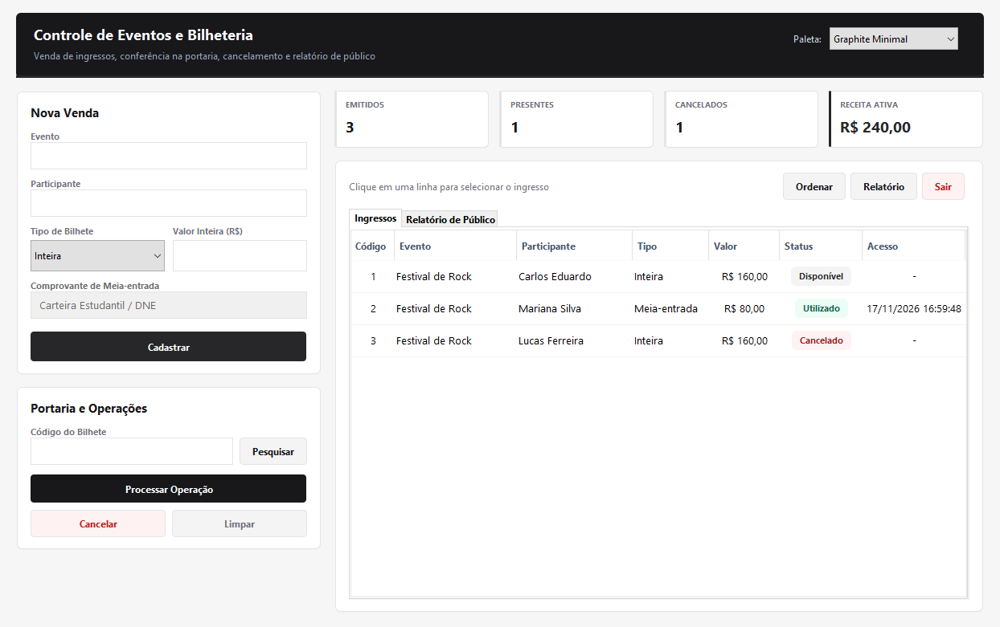
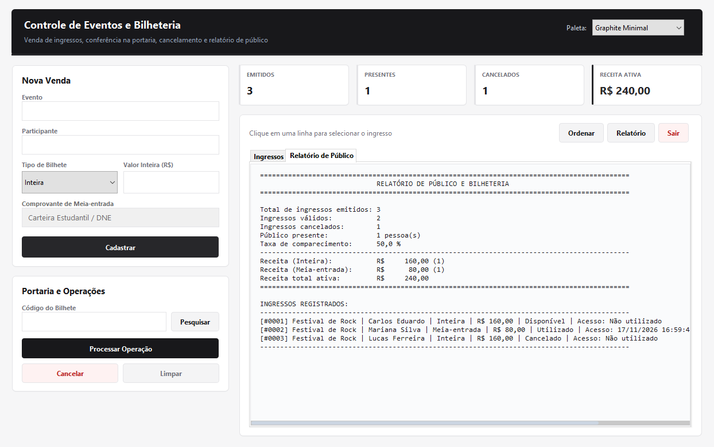
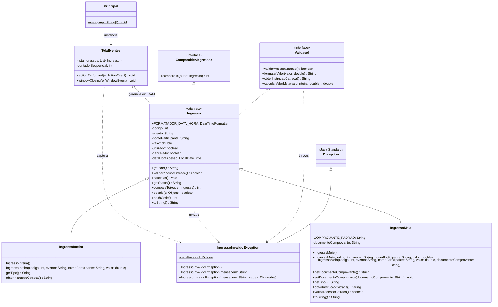
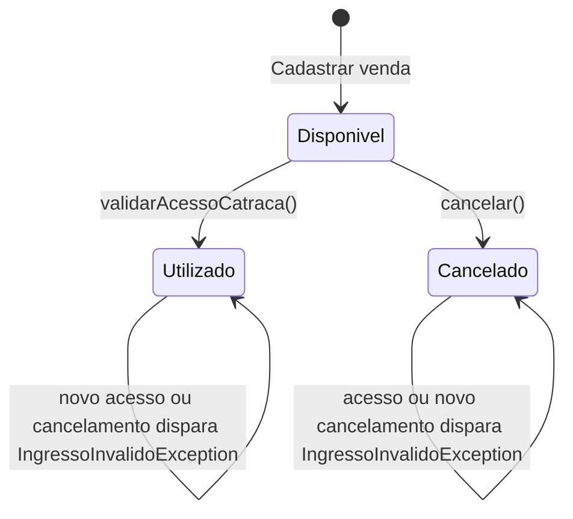

# Controle de Eventos e Venda de Ingressos


-3F3F46?style=flat-square)
-1D4ED8?style=flat-square)

Aplicação desktop desenvolvida em Java puro (`javax.swing.*` e `java.util.*`) para o gerenciamento de bilheteria e controle de portaria de eventos, mantendo todos os dados em memória RAM durante a execução. Projeto entregue como avaliação prática **P2** da disciplina de **Programação Orientada a Objetos** (materiais de referência **POO_07 a POO_10**).

---

## Sumário

1. [Identificação](#1-identificação)
2. [Tema Escolhido e Requisitos Atendidos](#2-tema-escolhido-e-requisitos-atendidos)
3. [Interface Gráfica](#3-interface-gráfica)
4. [Arquitetura e Modelagem](#4-arquitetura-e-modelagem)
5. [Instruções de Compilação e Execução](#5-instruções-de-compilação-e-execução)
6. [Roteiro de Testes Manuais](#6-roteiro-de-testes-manuais)
7. [Registro de Uso de IA Generativa](#7-registro-de-uso-de-ia-generativa)

---

## 1. Identificação

| Campo | Informação                             |
| :--- |:---------------------------------------|
| **Aluno** | Juan Ygor Delgado                      |
| **RA** | 1630482523043                          |
| **Curso** | Análise e Desenvolvimento de Sistemas  |
| **Turno** | Noturno                                |
| **Instituição** | FATEC Mogi Mirim                       |
| **Disciplina** | Programação Orientada a Objetos (POO)  |
| **Professor** | Prof Marcos Roberto de Moraes (Maromo) |
| **Referência** | Materiais POO_07 a POO_10              |

---

## 2. Tema Escolhido e Requisitos Atendidos

**Tema 08 — Controle de Eventos e Venda de Ingressos**

O sistema cobre o ciclo operacional de uma bilheteria: emissão de ingressos inteiros e meia-entrada, busca de bilhetes, conferência e baixa na portaria (catraca), cancelamento com validação de regras de negócio, ordenação da coleção em memória e geração de relatório consolidado de público e receita.

### Mapeamento dos Pilares da Disciplina

| Material | Conceito Exigido | Aplicação no Projeto |
| :--- | :--- | :--- |
| **POO_07** | GUI Swing (`JFrame`, `JTextField`, `JLabel`, `JButton`, `JTextArea`/`JScrollPane`), `ActionListener` e `WindowListener` | `TelaEventos` estende `JFrame`, implementa `ActionListener` e `WindowListener`, exibe tabela, área de relatório em `JTextArea` e confirma o fechamento em `windowClosing()`. |
| **POO_08** | Checked Exception customizada (`extends Exception`), tratamento de `NumberFormatException` e feedback via `JOptionPane` | `IngressoInvalidoException` lançada nas regras de catraca e cancelamento; validações numéricas de preço e código com captura de `NumberFormatException` e alertas visuais em `JOptionPane`. |
| **POO_09** | Persistência em memória (`List<T> = new ArrayList<>()`), `Comparable<T>`, `Collections.sort()`, `equals()` e `hashCode()` | `listaIngressos` mantida em RAM; `Ingresso` implementa `Comparable<Ingresso>` ordenando por código sequencial e sobrescreve `equals()`, `hashCode()` e `toString()`. |
| **POO_10** | Polimorfismo por interface própria com métodos abstratos, `default` e `static` | Interface `Validavel` define `validarAcessoCatraca()`, os métodos `default` `formatarValor()` e `obterInstrucaoCatraca()` e o método `static` `calcularValorMeia()`, especializados por `IngressoInteira` e `IngressoMeia`. |

---

## 3. Interface Gráfica

A tela principal foi organizada em duas colunas para separar entrada de dados e acompanhamento em tempo real, com indicadores resumidos no topo e alternância entre a grade de bilhetes e o relatório textual. O seletor no canto superior direito permite alternar entre duas paletas sóbrias: **Graphite Minimal** (padrão) e **Slate Blue**.

### Tela Principal — Venda, Portaria e Grade de Ingressos



### Aba Relatório de Público (`JTextArea`)



---

## 4. Arquitetura e Modelagem

### Estrutura de Diretórios

```text
Controle-eventos-ingressos/
├── docs/
│   ├── tela-principal.png
│   └── tela-relatorio.png
├── src/
│   └── br/
│       └── com/
│           └── eventos/
│               ├── exception/
│               │   └── IngressoInvalidoException.java
│               ├── interfaces/
│               │   └── Validavel.java
│               ├── model/
│               │   ├── Ingresso.java
│               │   ├── IngressoInteira.java
│               │   └── IngressoMeia.java
│               └── view/
│                   ├── Principal.java
│                   └── TelaEventos.java
├── executar.bat
└── README.md
```

### Diagrama de Classes (UML)



### Ciclo de Vida e Regras de Estado do Ingresso



### Responsabilidades das Classes

- **`br.com.eventos.interfaces.Validavel`**
  Estabelece o contrato de validação na portaria (`validarAcessoCatraca()`) e centraliza utilitários de negócio com recursos modernos de interface em Java: `formatarValor(double)` e `obterInstrucaoCatraca()` como métodos `default`, e `calcularValorMeia(double)` como método `static`.

- **`br.com.eventos.exception.IngressoInvalidoException`**
  Exceção checada que estende diretamente `java.lang.Exception`, forçando o tratamento explícito via `try-catch` na camada de visão em toda tentativa de acesso ou cancelamento inválido.

- **`br.com.eventos.model.Ingresso`**
  Classe abstrata central do domínio. Encapsula os dados do bilhete com getters e setters, controla os estados `utilizado` e `cancelado`, registra a `dataHoraAcesso` no momento da baixa e implementa:
  - `compareTo(Ingresso)`: ordenação natural crescente pelo código sequencial do bilhete.
  - `equals(Object)` e `hashCode()`: identidade baseada no par `(codigo, evento)`, usando `instanceof Ingresso` para manter a consistência entre subclasses polimórficas.
  - `toString()`: formatação tabular utilizada no relatório textual.

- **`br.com.eventos.model.IngressoInteira` e `IngressoMeia`**
  Subclasses concretas que demonstram polimorfismo na conferência de portaria. `IngressoInteira` libera acesso direto; `IngressoMeia` mantém `documentoComprovante`, sobrescreve `obterInstrucaoCatraca()` para orientar o operador a exigir o comprovante e valida sua presença em `validarAcessoCatraca()`.

- **`br.com.eventos.view.TelaEventos`**
  Formulário principal estendendo `JFrame` e implementando `ActionListener` e `WindowListener`. Mantém os dados em `List<Ingresso> listaIngressos = new ArrayList<>()`, disponibiliza os botões exigidos (`Cadastrar`, `Pesquisar`, `Processar Operação`, `Ordenar` e `Sair`, além de `Cancelar`, `Relatório` e `Limpar`), atualiza os totalizadores em tempo real e emite o relatório de público em `JTextArea`.

- **`br.com.eventos.view.Principal`**
  Ponto de entrada (`main`), responsável por aplicar o Look and Feel nativo do sistema operacional e iniciar `TelaEventos` na *Event Dispatch Thread* via `SwingUtilities.invokeLater`.

---

## 5. Instruções de Compilação e Execução

### Pré-requisitos

- **Java JDK 17** ou superior instalado e configurado na variável `PATH` (testado com JDK 21).
- Nenhuma biblioteca externa é necessária; o projeto utiliza apenas a API padrão do JDK.

### Execução rápida no Windows

Na pasta raiz do repositório, execute o script:

```bat
.\executar.bat
```

### Compilação e execução manual via terminal

```bat
if not exist bin mkdir bin
javac -encoding UTF-8 -d bin src\br\com\eventos\interfaces\*.java src\br\com\eventos\exception\*.java src\br\com\eventos\model\*.java src\br\com\eventos\view\*.java
java -cp bin br.com.eventos.view.Principal
```

### Execução via IDE (IntelliJ IDEA / NetBeans / Eclipse)

1. Abra a pasta raiz `Controle-eventos-ingressos` como projeto Java apontando `src` como *Sources Root*.
2. Execute a classe `br.com.eventos.view.Principal`.

---

## 6. Roteiro de Testes Manuais

A aplicação inicia com a lista em memória vazia (`0` registros). Para validar todas as regras de negócio durante a correção, siga a sequência abaixo:

| Cenário | Ação na Interface | Resultado Esperado |
| :--- | :--- | :--- |
| **Venda Inteira** | Preencher Evento, Participante, tipo `Inteira`, Valor `120,00` e clicar em `Cadastrar` | Bilhete `#1` criado com valor `R$ 120,00`, status `Disponível` e totalizadores atualizados. |
| **Venda Meia-entrada** | Selecionar `Meia-entrada (50%)`, informar Valor `120,00` e comprovante, clicar em `Cadastrar` | Campo de comprovante habilita automaticamente; bilhete `#2` criado com `R$ 60,00` via `Validavel.calcularValorMeia()`. |
| **Erro de formato numérico** | Informar `abc` em `Valor Inteira` ou no `Código do Bilhete` e acionar a operação | `NumberFormatException` capturada e mensagem exibida via `JOptionPane.showMessageDialog()`. |
| **Pesquisa** | Digitar `2` no campo `Código do Bilhete` (ou um nome em `Participante`) e clicar em `Pesquisar` | Campos preenchidos com os dados do bilhete localizado e linha selecionada na tabela. |
| **Validação na catraca** | Selecionar o bilhete `#1` (`Disponível`) e clicar em `Processar Operação` | Diálogo exibe a orientação polimórfica da portaria; ao confirmar, status muda para `Utilizado` com data/hora registrada. |
| **Exceção — Acesso duplicado** | Selecionar o bilhete `#1` (já `Utilizado`) e clicar em `Processar Operação` novamente | Dispara `IngressoInvalidoException` com aviso via `JOptionPane` informando o horário do uso anterior. |
| **Exceção — Cancelar bilhete usado** | Selecionar o bilhete `#1` (`Utilizado`) e clicar em `Cancelar` | Dispara `IngressoInvalidoException` impedindo o cancelamento de bilhete já utilizado. |
| **Cancelamento válido** | Selecionar o bilhete `#2` (`Disponível`) e clicar em `Cancelar` | Status alterado para `Cancelado` e receita ativa recalculada. |
| **Exceção — Ingresso cancelado** | Selecionar o bilhete `#2` (`Cancelado`) e clicar em `Processar Operação` | Dispara `IngressoInvalidoException` negando a liberação na catraca. |
| **Ordenação natural** | Clicar em `Ordenar` | Executa `Collections.sort(listaIngressos)` ordenando pelo código sequencial via `Comparable<Ingresso>`. |
| **Relatório de público** | Clicar em `Relatório` (ou na aba `Relatório de Público`) | Exibe o consolidado de emitidos, válidos, cancelados, público presente, taxa de comparecimento, receita e listagem completa no `JTextArea`. |
| **Fechamento da janela** | Clicar em `Sair` ou no botão `X` da janela | `WindowListener` intercepta o fechamento e solicita confirmação antes de encerrar a sessão em memória. |

---

## 7. Registro de Uso de IA Generativa

Em conformidade com a Regra 2 das diretrizes da P2, seguem documentados os prompts utilizados durante o desenvolvimento. A modelagem das regras de negócio e classes de domínio (`model`, `interfaces` e `exception`) foi estruturada a partir dos materiais POO_07 a POO_10, enquanto a IA foi utilizada como apoio na prototipagem, estilização e refinamento da interface gráfica em `javax.swing.*` (`TelaEventos.java`), além da revisão final dos requisitos.

### Interação 1 — Prototipagem da tela principal em Java Swing

- **Prompt utilizado:**
  > "Crie o layout de uma tela `JFrame` em Java Swing para um sistema de controle de eventos e venda de ingressos que manipula uma `List<Ingresso>` em memória. A tela precisa implementar `ActionListener` e `WindowListener`, conter campos para evento, participante, tipo (inteira/meia), valor e código, além dos botões `Cadastrar`, `Pesquisar`, `Processar Operação`, `Cancelar`, `Ordenar`, `Relatório`, `Limpar` e `Sair`, uma tabela de registros e uma `JTextArea` para o relatório de público."
- **Resposta obtida:**
  A IA gerou a estrutura visual inicial da `TelaEventos` organizada em duas colunas: cartões de formulário (venda e portaria) à esquerda e painel de acompanhamento à direita com totalizadores numéricos e `JTabbedPane` alternando entre `JTable` e `JTextArea` dentro de `JScrollPane`.
- **Refinamento realizado:**
  Integrei os eventos dos botões diretamente aos métodos da camada de domínio (`validarAcessoCatraca()`, `cancelar()`, `Validavel.calcularValorMeia()` e `Collections.sort()`), habilitei o campo de comprovante dinamicamente apenas para meia-entrada e configurei o listener de seleção da tabela para preencher o código do bilhete automaticamente.

### Interação 2 — Acabamento visual da interface em Swing puro

- **Prompt utilizado:**
  > "Melhore o visual dessa tela Swing usando apenas Java puro, sem bibliotecas externas: quero cards com bordas arredondadas, botões sem o estilo antigo padrão do Windows, badges arredondados na coluna de status da tabela e barras de rolagem mais finas."
- **Resposta obtida:**
  A IA implementou componentes internos customizados com `Graphics2D` (`PainelCard`, `BotaoModerno`, `CardKPI`, `StatusBadgeRenderer` e `ModernScrollBarUI`), aplicando antialiasing, cantos arredondados, efeito hover nos botões e pílulas centralizadas na coluna de status.
- **Refinamento realizado:**
  Ajustei as alturas máximas dos `JTextField` dentro do `BoxLayout` para evitar distorção vertical no campo de código, removi caracteres Unicode que renderizavam como blocos inválidos na fonte padrão do Windows e reduzi o rótulo dos status (`Disponível`, `Utilizado`, `Cancelado`) para evitar truncamento visual na tabela.

### Interação 3 — Paleta de cores sóbria e limpeza do código

- **Prompt utilizado:**
  > "A tela ficou muito colorida com botões de várias cores diferentes. Ajuste para uma paleta de cores mais clean e sóbria (fundo neutro, cards brancos e contraste consistente), deixe apenas Graphite Minimal como padrão e Slate Blue como segunda opção."
- **Resposta obtida:**
  A IA unificou os botões secundários em tons neutros com borda fina, restringiu o destaque visual aos botões principais (`Cadastrar` e `Processar Operação`) e ao card de receita ativa, manteve somente as duas paletas solicitadas no seletor.
- **Refinamento realizado:**
  Movi a classe `Principal` para o pacote `br.com.eventos.view`, ajustei o script `executar.bat` para o novo ponto de entrada, validei todas as regras de exceção, ordenação e polimorfismo em execução local e documentei os diagramas UML e roteiro de testes neste `README.md`.
